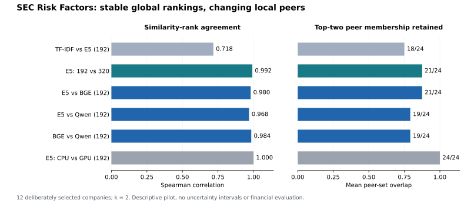

# SEC embedding stability: pilot results — 2026-11-03

**Snapshot:** completed initial model/chunk grid; eight runs, eight comparisons. [Initial six-comparison report](https://github.com/khalilalaei/sec-embedding-stability/blob/b7d6998ccea715791e7b218a0fb43b14cd351e81/reports/pilot_stability_2026-11-03.md) and its original evidence remain preserved.

**Finding:** global company-similarity rankings agree strongly across the three neural families, while top-two peer membership changes for specific companies. Economic or predictive value has not been tested.

These are descriptive results on 12 deliberately selected companies, one real 10-K Item 1A section per company. Original reporting periods range from November 2025 through June 2026. The 66 unordered company pairs are dependent observations, not 66 independent securities. Source extraction has AI-assisted boundary/source review, not an independent human audit.



## Recomputed comparisons

| Comparison | Rank correlation | Retained memberships | Changed peer sets / 12 | Changed closest peers / 12 | Jaccard |
|---|---:|---:|---:|---:|---:|
| TF-IDF vs E5 (192) | 0.717524 | 18/24 | 6 | 2 | 0.666667 |
| E5: 192 vs 320 | 0.991567 | 21/24 | 3 | 1 | 0.833333 |
| BGE: 192 vs 320 | 0.995491 | 22/24 | 2 | 1 | 0.888889 |
| Qwen: 192 vs 320 | 0.990022 | 23/24 | 1 | 0 | 0.944444 |
| E5 vs BGE (192) | 0.979877 | 21/24 | 2 | 2 | 0.861111 |
| E5 vs Qwen (192) | 0.968271 | 19/24 | 5 | 1 | 0.722222 |
| BGE vs Qwen (192) | 0.983927 | 19/24 | 4 | 2 | 0.750000 |
| E5: CPU vs GPU (192) | 1.000000 | 24/24 | 0 | 0 | 1.000000 |

Peer memberships are directed company-to-peer selections: 12 firms × 2 slots = 24. A changed set can replace either one or both members; a rank-order change can occur with no set change. Overlap is not a measure of economic correctness. Cross-model absolute cosine movements are exported as descriptive numbers only: the score scales differ.

E5 uses mean pooling, BGE CLS pooling, and Qwen last-token pooling, as recorded by the pinned SentenceTransformer checkpoints. All neural inference is recorded as float32; normalized document vectors are stored as float64 by the aggregation helper. Prefixes and model-specific pooling are part of the model-family configuration, so these comparisons do not isolate architecture alone.

## Key observations

- E5 192 versus 320: three companies change peer sets (JNJ, CAT, TGT); CAT also changes its closest peer. Similarity-rank correlation is 0.991567 despite these discrete changes.
- BGE 192 versus 320: JNJ replaces Walmart with Deere; DE replaces Walmart with Caterpillar and changes its closest peer from Target to Caterpillar.
- Qwen 192 versus 320: only Target changes its set, replacing Deere with Caterpillar; its closest peer remains Walmart.
- Across the three chunk contrasts, Qwen retains the most memberships while BGE has the highest rank correlation. These measure different aspects of stability; the pilot does not identify a generally superior model.
- E5 versus BGE: two companies change peer sets (CAT and DE). CAT replaces one member; DE replaces both. That yields three lost memberships, not three changed companies.
- E5 versus Qwen: five companies replace one member each (XOM, JNJ, MRK, CAT, DE). DE also changes its closest peer.
- BGE versus Qwen: four sets change (XOM, JNJ, MRK, DE), while CAT only reverses its two peers. DE replaces both members. This has the same 19/24 retention as E5 versus Qwen but a different distribution of changes.
- TF-IDF versus E5: six sets change; DE retains its set but reverses the order. TF-IDF identifies each deliberately selected industry partner as the closest peer (12/12); this selection diagnostic is not ground-truth financial performance.
- The E5 CPU/environment versus GPU/environment check preserves all peer sets and pair-similarity ranks. Mean absolute cosine difference is 5.093662662365843e-08. CPU and GPU PyTorch versions differ, so this checks the combined environment/device change for this E5 arm, not an isolated hardware effect or a universal guarantee.
- Small second-versus-third margins signal vulnerability, not a guaranteed switch: Chevron has a smaller initial margin than some changed companies but retains its set in the E5 budget contrast.

## Every changed peer order

Peer lists below are ordered closest first. The full company CSV also contains unchanged rows and both boundary margins.

### TF-IDF vs E5 (192)

| Company | Run A peers | Run B peers | Set changed? | Closest changed? | Margin A | Margin B |
|---|---|---|---|---|---:|---:|
| JPM | BAC, MSFT | BAC, CAT | Yes | No | 0.000605737 | 0.002751268 |
| BAC | JPM, ORCL | CAT, ORCL | Yes | Yes | 0.005855614 | 0.001254807 |
| CVX | XOM, JNJ | XOM, CAT | Yes | No | 0.001924670 | 0.000102707 |
| JNJ | MRK, ORCL | MRK, WMT | Yes | No | 0.004220563 | 0.000256379 |
| MRK | JNJ, WMT | JNJ, DE | Yes | No | 0.003554040 | 0.000815680 |
| CAT | DE, WMT | DE, ORCL | Yes | No | 0.001901683 | 0.000272254 |
| DE | CAT, ORCL | ORCL, CAT | No | Yes | 0.000371331 | 0.000336907 |

### E5: 192 vs 320

| Company | Run A peers | Run B peers | Set changed? | Closest changed? | Margin A | Margin B |
|---|---|---|---|---|---:|---:|
| JNJ | MRK, WMT | MRK, ORCL | Yes | No | 0.000256379 | 0.000342799 |
| CAT | DE, ORCL | BAC, DE | Yes | Yes | 0.000272254 | 0.000638933 |
| TGT | WMT, DE | WMT, ORCL | Yes | No | 0.000879816 | 0.000685925 |

### BGE: 192 vs 320

| Company | Run A peers | Run B peers | Set changed? | Closest changed? | Margin A | Margin B |
|---|---|---|---|---|---:|---:|
| JNJ | MRK, WMT | MRK, DE | Yes | No | 0.000772089 | 0.000112730 |
| DE | TGT, WMT | CAT, TGT | Yes | Yes | 0.000684619 | 0.000236682 |

### Qwen: 192 vs 320

| Company | Run A peers | Run B peers | Set changed? | Closest changed? | Margin A | Margin B |
|---|---|---|---|---|---:|---:|
| TGT | WMT, DE | WMT, CAT | Yes | No | 0.004953631 | 0.014489522 |

### E5 vs BGE (192)

| Company | Run A peers | Run B peers | Set changed? | Closest changed? | Margin A | Margin B |
|---|---|---|---|---|---:|---:|
| CAT | DE, ORCL | BAC, DE | Yes | Yes | 0.000272254 | 0.005390067 |
| DE | ORCL, CAT | TGT, WMT | Yes | Yes | 0.000336907 | 0.000684619 |

### E5 vs Qwen (192)

| Company | Run A peers | Run B peers | Set changed? | Closest changed? | Margin A | Margin B |
|---|---|---|---|---|---:|---:|
| XOM | CVX, DE | CVX, CAT | Yes | No | 0.002841438 | 0.003435181 |
| JNJ | MRK, WMT | MRK, DE | Yes | No | 0.000256373 | 0.000347191 |
| MRK | JNJ, DE | JNJ, WMT | Yes | No | 0.000815680 | 0.009545611 |
| CAT | DE, ORCL | DE, BAC | Yes | No | 0.000272256 | 0.008834614 |
| DE | ORCL, CAT | CAT, JNJ | Yes | Yes | 0.000336912 | 0.004411342 |

### BGE vs Qwen (192)

| Company | Run A peers | Run B peers | Set changed? | Closest changed? | Margin A | Margin B |
|---|---|---|---|---|---:|---:|
| XOM | CVX, DE | CVX, CAT | Yes | No | 0.011129853 | 0.003435181 |
| JNJ | MRK, WMT | MRK, DE | Yes | No | 0.000772089 | 0.000347191 |
| MRK | JNJ, DE | JNJ, WMT | Yes | No | 0.002993746 | 0.009545611 |
| CAT | BAC, DE | DE, BAC | No | Yes | 0.005390067 | 0.008834614 |
| DE | TGT, WMT | CAT, JNJ | Yes | Yes | 0.000684619 | 0.004411342 |

### E5: CPU vs GPU (192)

No peer membership or order changes.

## What was verified

- 53 saved run-output hashes and all 8 comparison-to-manifest links match the uploaded evidence.
- 49 distinct original/text/extraction-evidence files match the corpus's declared hashes using the earlier supplied source package.
- Corpus identities, order and snapshot contents match across all 8 completed runs. Recorded code commits: `5026930dce1d579dd29dfed6f473339b0221b87d`, `b7d6998ccea715791e7b218a0fb43b14cd351e81`. No tracked working-tree modifications are recorded. The inference CLI and numerical core are unchanged across these commits. Earlier GPU runs recorded an untracked `.venv-gpu/` directory, which is now ignored.
- Saved neural embeddings are finite, row-normalized, and reproduce each saved cosine matrix to numerical precision. Each saved peer list and margin was recomputed.
- All 192-budget neural run records have identical 890 source chunks; all available 320-budget arms have identical 510 source chunks. Every source-span hash and complete nonoverlapping character coverage were checked.
- TF-IDF term counts, vocabulary, document frequencies, IDF values, normalization and the similarity matrix were rebuilt from the exact extracted source text.
- All 8 comparison summaries and 96 company-level comparison rows were recomputed from matrices using a separate ranking implementation.

**Verification boundary:** this is the same assistant reviewing supplied artifacts. Neural inference, pretrained weight hashes and tokenizer-budget counting were not independently rerun. A recorded revision identifies the requested checkpoint; cached model weights themselves were not supplied. The two source parsers used earlier share selection/cleanup rules, so their agreement is not an independent validation of those rules.

## Recorded run configurations

| Run | Model / representation | Budget | Device | PyTorch | Batch | Source chunks |
|---|---|---:|---|---|---:|---:|
| pilot_bge_192 | bge | 192 | cpu | 2.15.0+cpu | 8 | 890 |
| pilot_bge_320 | bge | 320 | cpu | 2.15.0+cpu | 8 | 510 |
| pilot_e5_192 | e5 | 192 | cpu | 2.15.0+cpu | 8 | 890 |
| pilot_e5_192_gpu | e5 | 192 | cuda | 2.14.1+cu126 | 8 | 890 |
| pilot_e5_320 | e5 | 320 | cpu | 2.15.0+cpu | 8 | 510 |
| pilot_qwen_192_gpu | qwen | 192 | cuda | 2.14.1+cu126 | 1 | 890 |
| pilot_qwen_320_gpu | qwen | 320 | cuda | 2.14.1+cu126 | 1 | 510 |
| pilot_tfidf | TF-IDF | — | CPU | not used | — | — |

The GPU identifies as NVIDIA GeForce RTX 3050 Laptop GPU, with recorded CUDA runtime 12.6. The user-reported 4 GB GPU memory is separate from system RAM. BGE–Qwen spans CPU/GPU environments; the E5 check is reassuring but is not a BGE-specific GPU control. No speed, memory-usage or cost benchmark is claimed.

Budgets are total tokenizer lengths, including prefixes and special tokens, not words or body-token counts. Source spans are shared across the locked tokenizers. Qwen uses a fixed symmetric instruction; no instruction sensitivity test has run. Aggregation is an equal mean of normalized chunk vectors followed by document L2 normalization. Each arm has one fixed-weight inference, not independent training-seed replications.

## Evidence and reproduction

- [Audited matrices, run receipts, hashes and all comparison rows](../results/pilot_2026-11-03_complete/verified_evidence.json)
- [Comparison CSV](../results/pilot_2026-11-03_complete/comparison_summary.csv)
- [All company peer changes and margins](../results/pilot_2026-11-03_complete/company_peer_changes.csv)
- [Exact recorded model register](../configs/models.pilot_2026-11-03.lock.json)
- [Offline audit script](../scripts/audit_pilot_results.py)
- [Report/figure renderer](../scripts/render_pilot_report.py)

The curated evidence contains matrices and sanitized receipts, not local absolute paths, raw filings, full source text, model weights or full environment directories. Original upload hashes are receipts for the preserved user archives; they are not hashes of normalized report files. Full hash/source verification requires the original `pilot-results-complete.zip` and matching source/extraction files. The publicized table/figure can be regenerated from the curated JSON without model inference.

```powershell
.\.venv\Scripts\python.exe -m pip install -e ".[report]"
.\.venv\Scripts\python.exe scripts/audit_pilot_results.py --archive pilot-results-complete.zip --source-project . --output audit_check.json
.\.venv\Scripts\python.exe scripts/render_pilot_report.py --evidence results/pilot_2026-11-03_complete/verified_evidence.json --repo .
```

## Limits and next experiments

This pilot does not establish incremental financial value, causality, model superiority, historical tradability or absence of look-ahead bias. It has one selected filing per company, mixed reporting periods, no historical point-in-time index sample, unknown model training/fine-tuning cutoffs, no financial targets and no held-out economic evaluation. TF-IDF was fitted to the whole descriptive corpus; that fit rule is unsuitable for a claimed historical forecast. No significance test or uncertainty interval is inferred from dependent company pairs.

The initial three-model, two-budget grid is complete: E5 and BGE contrasts use their original CPU environment, and Qwen uses its GPU environment at both budgets. Third-party package versions, Python, inference settings, precision and batch size match within each model’s chunk contrast. BGE’s project-distribution metadata changes from 0.1.0 to 0.2.0; the inference CLI and numerical core are byte-identical across its recorded commits. This metadata exception is logged explicitly. Additional instruction, boundary/overlap and aggregation perturbations remain unrun. Next freeze the financial task, chronology, controls, data sources and inference plan with the team before expanding to point-in-time covariance/risk, volatility or return tests.
