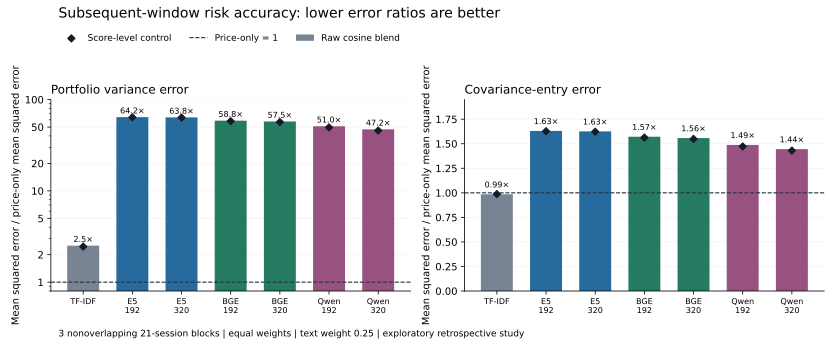

# First subsequent-window risk accuracy test — 2026-11-14

At the fixed 25% text weight, **0 of 7 primary representations reduced mean squared portfolio variance error** across three subsequent 21-session blocks. The neural blends had 47.2–64.2 times the price-only error. TF-IDF had 2.51 times the portfolio error, while reducing covariance-entry error by 1.45%. These results concern this uncalibrated blend, selected sample, three windows and assumed timing; they do not establish that embeddings cannot improve financial models.



## Fixed design and exact windows

The [protocol](../docs/RISK_ACCURACY_PROTOCOL.md) and [config](../configs/risk_accuracy_v1.json) were committed at `0d6d166d13d14dcda89771a61bf59b5b7627bbc8` before window-loss evaluation. This is not an untouched holdout: the earlier November snapshot already summarized returns containing these dates. No losses were used to select models, text weights or windows.

| Decision close (New York) | Trailing return dates (252) | Subsequent return dates (21) |
|---|---|---|
| 2026-07-31 | 2025-07-31 – 2026-07-31 | 2026-08-03 – 2026-08-31 |
| 2026-08-31 | 2025-08-29 – 2026-08-31 | 2026-09-01 – 2026-09-30 |
| 2026-09-30 | 2025-09-30 – 2026-09-30 | 2026-10-01 – 2026-10-29 |

The October month-end candidate rolled back to October 30 and was excluded: only one subsequent return was available in the frozen dataset, versus 21 required. The horizon was not shortened. The three admitted evaluation windows do not overlap; their estimation windows do overlap.

For the diagnostic timing assumption, each filing becomes eligible at the close of the first XNYS session strictly after its SEC acceptance local date. The latest assumed eligibility is Microsoft, July 30, 2026 at 20:00 UTC. These are explicitly assumption-only AI-assisted records, not independently approved execution eligibility. The original pending security/availability statuses were not changed.

Fit centered Ledoit–Wolf covariance B to trailing returns. With D=diag(sqrt(diag(B))), use C=0.75B+0.25DKD and equal weights w=1/12. Marginal variances stay fixed. The realized daily covariance proxy is the centered sample covariance of the next 21 return vectors (ddof=1). Its portfolio proxy is wᵀS_future w, independently checked against the sample variance of the equal-weight daily return series.

Primary loss is (wᵀCw − wᵀS_future w)². Secondary loss averages (C_ij − S_future,ij)² across all 144 entries; off-diagonal loss across 132 entries is also saved. Aggregate losses are equal means across the three dates. Ratios below divide each aggregate model loss by the matching aggregate price-only loss. They are error ratios, not volatility ratios or investment returns.

## Primary weight results

| Representation | Portfolio error / baseline | Covariance error / baseline | Portfolio-error wins |
|---|---:|---:|---:|
| Price-only | 1.00× | 1.00× | Reference |
| TF-IDF | 2.51× | 0.985× | 0/3 |
| E5 192 | 64.19× | 1.631× | 0/3 |
| E5 320 | 63.77× | 1.626× | 0/3 |
| BGE 192 | 58.78× | 1.571× | 0/3 |
| BGE 320 | 57.52× | 1.558× | 0/3 |
| Qwen 192 | 51.03× | 1.488× | 0/3 |
| Qwen 320 | 47.19× | 1.445× | 0/3 |

The primary mean price-only portfolio variance squared error is 1.20507232e-10, in daily decimal-return variance squared. Its covariance-entry MSE is 1.33253207e-08. Error ratios can be large when the reference error is small; retain the absolute losses alongside ratios.

## Did score level explain the neural result?

The supplementary control uses K_level=(1−c)I+c11ᵀ, where c is the mean off-diagonal cosine of the corresponding kernel. This preserves the model’s average score level and discards firm-specific pair structure. It remains PSD and uses the same 25% blend weight.

| Representation | Full-kernel portfolio error / baseline | Score-level control / baseline |
|---|---:|---:|
| TF-IDF | 2.51× | 2.45× |
| E5 192 | 64.19× | 63.90× |
| E5 320 | 63.77× | 63.47× |
| BGE 192 | 58.78× | 58.01× |
| BGE 320 | 57.52× | 56.72× |
| Qwen 192 | 51.03× | 49.64× |
| Qwen 320 | 47.19× | 45.76× |

The full neural kernels and their score-level controls have similar portfolio losses. This is consistent with the already-observed high cosine levels driving much of the increase in estimated co-movement under the direct mapping. It does not prove that company-specific semantic information is useless. Raw document cosine is not a calibrated return correlation. TF-IDF’s small covariance-error reduction and larger portfolio-error increase show why these metrics must be reported separately: the portfolio quadratic form and matrix-entry average weight errors differently.

## Per-window estimated versus realized risk

| Evaluation block | Price-only annualized SD | Realized proxy annualized SD | Neural estimated SD range |
|---|---:|---:|---:|
| 2026-08-03 – 2026-08-31 | 11.09% | 10.98% | 17.07%–17.97% |
| 2026-09-01 – 2026-09-30 | 11.16% | 10.56% | 17.32%–18.24% |
| 2026-10-01 – 2026-10-29 | 11.09% | 8.77% | 16.91%–17.80% |

Annualization uses sqrt(252 × daily variance). The realized value is an annualized 21-day sample proxy; it is not a realized year-long return or volatility estimate. The estimators use no subsequent-window values when fitting each baseline.

## Complete evidence and limits

Saved outputs contain 147 window-loss rows (49 arms/settings per date), 49 aggregate rows, all four calendar candidates/exclusions, 12 assumption records, baseline and realized covariance matrices for all three windows, and code/config/data receipts. The fixed supplementary text-weight grid is preserved, with no winning weight selected. The E5 GPU arm is a combined environment diagnostic and is excluded from the seven primary representation counts.

Only 3 blocks and 12 deliberately selected companies are available; daily rows, firm pairs and model arms are not independent replicates. No significance tests, confidence intervals or general predictive-superiority claims are made. The November embeddings postdate all evaluation windows and model training cutoffs are unknown. Yahoo revised adjusted-price histories, vendor aliases, the XOM successor assumption and unapproved historical execution eligibility remain limitations. This is an assumption-based retrospective loss diagnostic, not an absence-of-look-ahead result.

Large provider observations were retained under the frozen no-deletion rule. A post-run event-context check found Oracle’s September 9, 2025 earnings announcement immediately before its September 10 price jump, and Target’s November 20, 2024 earnings announcement on its large-decline date. These issuer releases support event context only; they do not independently verify the Yahoo price magnitudes. Target’s 2024 event is outside all fitted windows. This review did not alter observations, estimators or exclusions. Sources: https://www.oracle.com/news/announcement/q1fy26-earnings-release-2025-09-09/ and https://corporate.target.com/press/release/2024/11/target-corporation-reports-third-quarter-earnings .

## Reproduce locally

```powershell
.\.venv\Scripts\python.exe scripts\run_risk_accuracy.py
```

Requires the existing market extra, frozen local yahoo_pilot_v2 and corpus. No download, GPU, embedding inference or WRDS access is needed. The output directory runs/risk_accuracy_v1 must not already exist. Aggregate reference results are in results/risk_accuracy_2026-11-14/. The receipt records the protocol commit and exact computation/data/config hashes. The optional report extra supports scripts/render_risk_accuracy.py.

The next research question is whether calibrated dependence targets and company-specific text add value beyond score-level, price and industry/factor controls on a larger independently evaluated sample. Those extensions have not run; the present null/adverse results remain part of the record.
