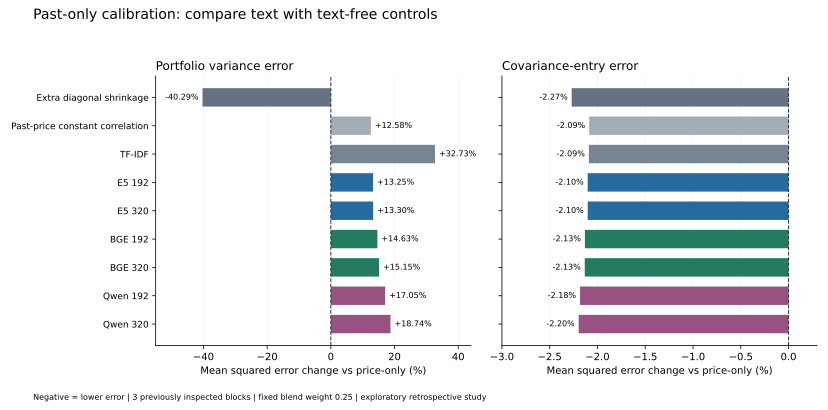

# Past-only shrinkage calibration — exploratory results

Calibration sharply reduced the original raw-neural error, but **0 of 7 primary representations beat price-only portfolio variance accuracy**. All seven reduced covariance-entry error by 2.09%–2.20% versus price-only. However, extra diagonal shrinkage with no text reduced covariance-entry error by 2.27% and portfolio variance error by 40.29%, outperforming every calibrated text setting on both aggregate losses in these three blocks. An incremental benefit from text is not established.



## Fixed specification and chronology

The [protocol](../docs/RISK_CALIBRATION_PROTOCOL.md) and [config](../configs/risk_calibration_v1.json) were committed at `ab048039081292e123d297019721ba503448e5ed` before calibrated loss evaluation. This extension was designed after observing the raw-blend failures and reuses the same three inspected windows; it is method development, not fresh validation. Original raw results and their adverse findings remain unchanged.

At each July 31, August 31 and September 30 decision, fit Ledoit–Wolf covariance B on 252 trailing returns and convert it to correlation R_B. For a saved document cosine matrix K, fit alpha=clip(sum_{i<j} K_ij R_B,ij / sum_{i<j} K_ij², 0, 1); a zero denominator gives zero. The target is K_cal=(1−alpha)I+alpha K. Blend C=0.75B+0.25D K_cal D with D=diag(sqrt(diag(B))). Subsequent 21-session realized risk is used only for loss evaluation.

This one-parameter fit attenuates off-diagonal cosine scores and cannot amplify them or change their relative pattern. Its objective is fitting trailing price correlation, not minimizing future portfolio error. K_cal and C remain PSD, and stock marginal variances remain fixed. The pairwise fit does not treat 66 pairs as independent for inference.

The blend decomposes as C=0.75B+0.25(1−alpha)diag(B)+0.25alpha D K D. Calibration therefore introduces additional diagonal shrinkage as well as rescaling text. That is why the price-only controls are necessary.

## Aggregate error changes versus price-only

Negative changes below mean lower mean squared error. These are relative changes in loss, not changes in volatility or investment returns.

| Estimator / control | Portfolio variance error change | Covariance-entry error change |
|---|---:|---:|
| Price-only | Reference | Reference |
| Extra diagonal shrinkage (no text) | -40.29% | -2.27% |
| Past-price constant correlation (no text) | +12.58% | -2.09% |
| TF-IDF | +32.73% | -2.09% |
| E5 192 | +13.25% | -2.10% |
| E5 320 | +13.30% | -2.10% |
| BGE 192 | +14.63% | -2.13% |
| BGE 320 | +15.15% | -2.13% |
| Qwen 192 | +17.05% | -2.18% |
| Qwen 320 | +18.74% | -2.20% |

Both controls use the same 25% blend weight. The constant-correlation target uses the mean off-diagonal trailing price correlation and contains no text. No estimator or parameter was selected using these outcomes. All per-window and absolute losses are saved alongside percentage comparisons.

## Does company-specific text help after calibration?

Each raw score-level kernel receives its own coefficient fitted by the same rule. With an interior coefficient and a constant off-diagonal cosine c, alpha*c equals the mean trailing price correlation. All 48 fits were interior in this run, so all calibrated level-only targets reduce to the past-price constant-correlation control. This equality was verified numerically.

| Representation | Portfolio-error improvement vs calibrated level-only | Covariance-error improvement vs calibrated level-only |
|---|---:|---:|
| TF-IDF | -17.892% | +0.003% |
| E5 192 | -0.595% | +0.016% |
| E5 320 | -0.634% | +0.016% |
| BGE 192 | -1.815% | +0.046% |
| BGE 320 | -2.282% | +0.047% |
| Qwen 192 | -3.968% | +0.098% |
| Qwen 320 | -5.467% | +0.112% |

Positive improvement means the full calibrated kernel has lower error than its calibrated level-only control. Company-specific structure gives small covariance-loss improvements over that control here, while worsening portfolio variance error. The text-free diagonal target still has lower aggregate error on both metrics than every calibrated text arm. These metric-specific outcomes do not support a general text-value claim.

## Fitted scale factors

| Representation | Minimum alpha | Maximum alpha |
|---|---:|---:|
| TF-IDF | 0.4620 | 0.5521 |
| E5 192 | 0.0500 | 0.0597 |
| E5 320 | 0.0502 | 0.0600 |
| BGE 192 | 0.0533 | 0.0639 |
| BGE 320 | 0.0543 | 0.0651 |
| Qwen 192 | 0.0593 | 0.0712 |
| Qwen 320 | 0.0632 | 0.0759 |

All coefficients, unconstrained coefficients, fitting intervals, objective losses and pair counts are retained. Alpha is fitted per date rather than chosen from a future-loss grid. No best model or coefficient is selected from the report.

## Evidence and limitations

Outputs contain 81 window-loss rows, 27 aggregate rows, 48 fit records and 40 comparisons (eight settings against five references). Seven settings are primary; E5 GPU is a separate environment diagnostic. Raw/reference losses reproduce the original accuracy study within floating-point tolerance. After enhancing only summary counters, unchanged numerical outputs reproduced byte-for-byte.

The 12 selected firms, three reused blocks, overlapping training windows, unknown model cutoffs, November-generated embeddings, Yahoo revised adjusted-price proxies, assumed eligibility and XOM successor link have the same limitations as the earlier reports. Price information is used both by the baseline and calibration. This is not a fresh out-of-sample validation, a look-ahead-free historical forecast, a return forecast or a trading-profit result. No significance tests, confidence intervals, optimized portfolios, transaction costs or expanded-sample results were introduced.

The useful finding is methodological: a gain against a single price baseline can be explained by a stronger text-free covariance control. Further development needs an independently reserved or prospective evaluation and price/industry controls; repeatedly adapting methods to these three blocks cannot establish general predictive value.

## Reproduce locally

```powershell
.\.venv\Scripts\python.exe scripts\run_risk_calibration.py
```

Uses the existing frozen local market/corpus files and saved kernels; no GPU or download is needed. The output runs/risk_calibration_v1 must not already exist. Reference outputs and provenance are in results/risk_calibration_2026-11-14/. The report extra supports scripts/render_risk_calibration.py.
