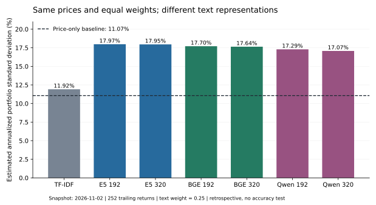

# First financial sensitivity snapshot — 2026-11-14

Changing the text representation changes estimated portfolio risk even when prices, marginal stock variances and portfolio weights stay fixed. In this one-date retrospective snapshot, the neural settings imply annualized portfolio standard deviations of 17.07%–17.97%, versus 11.07% for the price-only estimate. This is sensitivity of an uncalibrated estimator, not evidence of better risk prediction or profitable returns.



## Fixed experiment

- Snapshot date: 2026-11-02, the pre-existing collection endpoint. Latest 252 daily proxy returns, 2025-10-31 through 2026-11-02. No evaluation window is used.
- Universe and order: the same 12 companies/documents used by the audited embedding pilot; equal weights of 1/12, held fixed across settings.
- Price-only covariance B: centered Ledoit–Wolf, fitted to those 252 returns.
- For saved document cosine kernel K, define D = diag(sqrt(diag(B))) and C = 0.75 B + 0.25 D K D. This preserves the baseline marginal variances to floating-point precision and changes dependence.
- Estimated daily portfolio variance is wᵀ C w. Annualized standard deviation is sqrt(252 × wᵀ C w). This is an annualized daily-risk convention, not a forecast of a year-long buy-and-hold outcome.
- The primary 0.25 text weight, lookback and equal weights follow the existing design. The fixed supplementary grid is 0, 0.10, 0.25, 0.50, 1.00; none is selected using outcomes. Date, exact settings and contrast lists are in configs/risk_snapshot_v1.json. This is a documented exploratory specification, not formal preregistration.
- Seven primary representations plus the separate E5 GPU environment diagnostic produce 40 grid rows and eight primary-weight contrasts. The GPU arm is excluded from representation-range summaries.

## Estimated portfolio risk at text weight 0.25

| Representation | Annualized estimated SD | Variance change vs price-only | Mean off-diagonal text cosine |
|---|---:|---:|---:|
| TF-IDF | 11.92% | +15.99% | 0.1305 |
| E5 192 | 17.97% | +163.81% | 0.9716 |
| E5 320 | 17.95% | +163.22% | 0.9681 |
| BGE 192 | 17.70% | +156.01% | 0.9229 |
| BGE 320 | 17.64% | +154.13% | 0.9119 |
| Qwen 192 | 17.29% | +144.18% | 0.8492 |
| Qwen 320 | 17.07% | +137.93% | 0.8129 |

Price-only estimated SD: **11.07%**. Every marginal stock variance remains fixed; these portfolio-risk differences arise from the dependence target.

## Which choices move the financial estimate?

| Change A → B | Portfolio variance change relative to A | Annualized SD change (percentage points) |
|---|---:|---:|
| TF-IDF → E5 192 | +127.454% | +6.0557 |
| E5 192 → E5 320 | -0.226% | -0.0203 |
| BGE 192 → BGE 320 | -0.735% | -0.0652 |
| Qwen 192 → Qwen 320 | -2.559% | -0.2227 |
| E5 192 → BGE 192 | -2.958% | -0.2679 |
| E5 GPU 192 (diagnostic) → Qwen 192 | -7.442% | -0.6817 |
| BGE 192 → Qwen 192 | -4.621% | -0.4139 |

The CPU/GPU environment diagnostic changes estimated variance by about −0.0000031% relative to the CPU estimate; it remains a combined hardware/software check. Chunk changes produce smaller risk shifts than the E5/Qwen family comparison here, even though peer sets also changed in the earlier text study. These are observations from one selected universe and date. They establish no general ranking of models.

## Why the large difference from price-only?

A document cosine is not an estimated return correlation. These neural document vectors have very high positive pairwise cosines, so directly inserting their raw Gram matrix as a dependence target mechanically raises co-movement and equal-weight portfolio variance in this sample. TF-IDF has a different cosine scale. Cross-model variation therefore mixes score level, common direction/anisotropy and pair-specific information. High rank stability does not guarantee calibrated financial risk estimates.

The text-weighted risk estimates are not validated as accurate. The finding motivates future training-only calibration, common-component controls, sector/factor comparators and shuffled-document checks. Such extensions must be specified and evaluated separately; they were not fitted to improve this snapshot. Larger or smaller estimated risk alone is not a benefit.

## Chronology and remaining limits

The embeddings were generated on November 3, after this November 2 price snapshot. This is explicitly retrospective mechanical integration, with no historical trade decision, approved filing-eligibility timestamps, return forecast, future realized covariance, forecast-error test, optimized holdings, turnover or transaction-cost result. The runner verifies source acceptance precedes the snapshot, but does not convert that check into approved trading eligibility. Unknown model-training cutoffs remain unresolved.

Inputs are Yahoo adjusted-price proxies with vendor-scoped aliases and revised histories, not CRSP permanent-security total returns. The XOM predecessor/successor link, provider actions, retained extreme observations and identity-review scope are documented in reports/market_audit_2026-11-14.md. No raw prices or per-day returns are published. The original review statuses are preserved. The protocol’s stricter gates continue to apply before historical outcome evaluation.

## Reproduce

From the repository root, with the existing market extra installed:

```powershell
.\.venv\Scripts\python.exe scripts\run_risk_snapshot.py
```

The default output is runs/risk_snapshot_v1 and must not already exist. It re-audits local market files without downloading or invoking any embedding model; a CPU is sufficient. Aggregate reference results are in results/risk_snapshot_2026-11-14/. The receipt records exact data, config, code hashes and runtime versions. To regenerate the figure/report, install the report extra and run scripts/render_risk_snapshot.py. Small floating-point differences across runtime versions are possible.

Next substantive test: whether any text augmentation improves error against future realized risk, under explicit eligibility and outcome-window rules. That test has not run.
